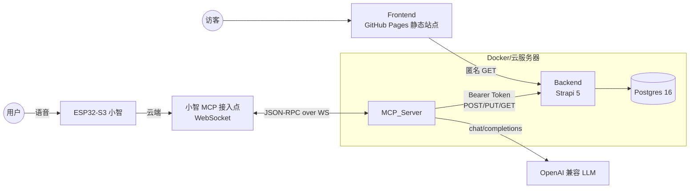
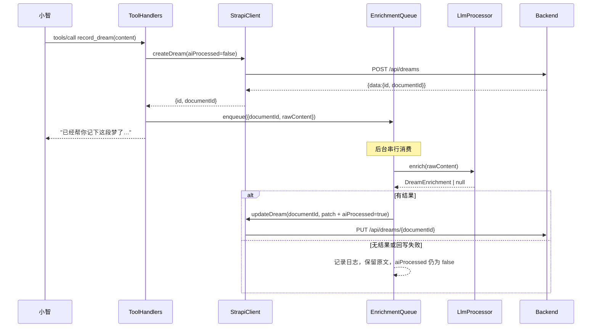
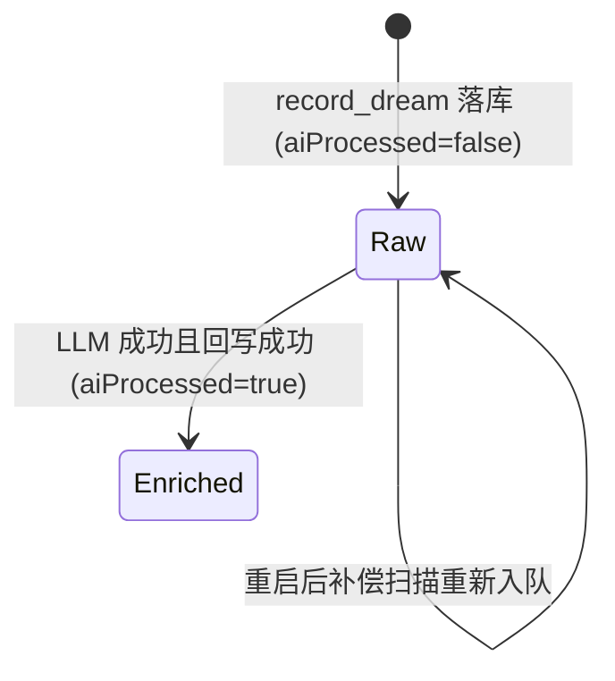

# 设计文档：Dream Blog（梦境日记）

## Overview

Dream Blog 是一个 monorepo，由三个独立运行的子项目组成：

- **Backend**（`backend/`）：Strapi 5.61.0 CMS，定义 `dream` 集合类型，对外提供 REST API。
- **MCP_Server**（`mcp-server/`）：TypeScript 常驻进程（Node 20，ESM）。它作为 WebSocket 客户端连接小智官方 MCP 接入点，暴露 `echo` 与 `record_dream` 两个工具。它负责把梦境原文快速写入 Strapi，并在后台调用 OpenAI 兼容 LLM 做结构化加工后回写。
- **Frontend**（`frontend/`）：Nuxt 4 纯静态站点（`ssr:false`），匿名只读访问 Backend，提供日记流、详情页与统计图表。

本文档由现有代码反向整理，描述现状。凡与 `requirements.md` 不一致之处，都集中记录在「需求与现状差异」一节，并在相关组件处用「⚠ 差异 D-n」标注。**本次工作不修改任何代码。**

### 关键设计决策

| 决策 | 理由 |
| --- | --- |
| 先落库、后加工（record_dream 立即回话，LLM 在后台队列中处理） | 语音交互需要快速响应；LLM 失败也不能丢原文 |
| 单 worker 串行队列 | 避免并发压垮 LLM 代理或触发限流；实现简单 |
| `aiProcessed` 标志 + 启动补偿扫描 | 进程崩溃或 LLM 失败后，下次启动可补做加工，无需额外持久化队列 |
| 前端纯静态、只读 | 部署到 GitHub Pages，无服务端；写权限只在 MCP_Server 的 Token 里 |
| LLM 密钥仅存在于 MCP_Server 环境 | Backend 与 Frontend 不接触密钥 |
| 聚合逻辑抽成纯函数（`utils/aggregate.ts`） | 便于单元测试和属性测试，与图表渲染解耦 |

## Architecture



### 记录梦境的时序



### 部署拓扑

- **本地开发**：三个子项目各自 `npm run dev` / `develop`，各读取自己目录下的 `.env`；Backend 默认 SQLite。
- **自托管**：根目录 `docker-compose.yml` 编排 `postgres`、`backend`、`mcp-server`，读取根目录 `.env`。
- **前端**：GitHub Actions 构建后发布到 GitHub Pages。

## Components and Interfaces

### 1. Backend（`backend/`）

#### 1.1 内容类型

`src/api/dream/content-types/dream/schema.json`：集合类型 `dreams`，`draftAndPublish:false`。控制器、路由、服务均使用 Strapi 核心工厂（`createCoreController/Router/Service('api::dream.dream')`），没有自定义逻辑。`src/index.ts` 的 `register` 与 `bootstrap` 为空。

#### 1.2 REST 接口

由核心路由提供：`GET /api/dreams`、`GET /api/dreams/:id`、`POST /api/dreams`、`PUT /api/dreams/:id`、`DELETE /api/dreams/:id`。`:id` 在 Strapi 5 中是 `documentId`。

`config/api.ts`：`defaultLimit=25`、`maxLimit=100`、`withCount=true`。因此前端与补偿扫描使用的 `pageSize=100` 恰好是上限。

#### 1.3 访问控制与引导脚本

`scripts/setup-access.js`（`node ./scripts/setup-access.js`）：

1. `compileStrapi()` → `createStrapi().load()`，日志级别降为 `error`。
2. 通过 `admin::api-token` 服务按名称 `mcp-server-write` 查找。不存在则创建 `full-access`、`lifespan:null` 的 Token，并仅在创建时打印明文；存在则打印「无法再次显示明文」提示。
3. 查询 `type=public` 的角色。存在时，对 `api::dream.dream.find` 与 `api::dream.dream.findOne` 逐个检查权限记录，缺失才创建，已有则打印「已有权限」。角色不存在则打印提示并跳过。
4. 成功后 `process.exit(0)`；任何异常打印错误并 `process.exit(1)`。

写操作没有对 Public 开放，因此匿名 POST/PUT/DELETE 会被 Strapi 拒绝（401/403）。

#### 1.4 中间件与服务配置

- `config/middlewares.ts`：`strapi::cors` 的 `origin` 为 `env.array('CORS_ORIGIN', ['http://localhost:3000','http://localhost:4173'])`。
- `config/server.ts`：`HOST`（默认 `0.0.0.0`）、`PORT`（默认 `1337`）、`APP_KEYS`。
- `config/database.ts`：`DATABASE_CLIENT` 默认 `sqlite`，文件为 `path.join(__dirname,'..','..',DATABASE_FILENAME ?? '.tmp/data.db')`。`postgres` 分支读取 `DATABASE_URL`（`connectionString`）以及 `DATABASE_HOST/PORT/NAME/USERNAME/PASSWORD/SSL*/SCHEMA`，并配置连接池。数据库连接失败时由 Strapi 启动流程直接失败，不回退 SQLite。

### 2. MCP_Server（`mcp-server/src/`）

| 文件 | 职责 |
| --- | --- |
| `config.ts` | `loadConfig()`：读取并校验环境变量，`dotenv/config` 自动加载 `.env` |
| `index.ts` | 装配组件、注册 MCP 请求处理器、连接传输层、启动补偿、优雅退出 |
| `ws-transport.ts` | `WebSocketClientTransport implements Transport`：WS 连接、消息收发、指数退避重连 |
| `tools.ts` | `TOOL_DEFINITIONS` 与 `ToolHandlers`（`echo`、`record_dream`） |
| `strapi-client.ts` | `StrapiClient`：`createDream`、`updateDream`、`listUnprocessed`、`ping` |
| `llm-processor.ts` | `LlmProcessor`：`enrich`、`parseAndValidate` |
| `enrichment-queue.ts` | `EnrichmentQueue`：`enqueue`、`recover`、`drain`、`size` |
| `logger.ts` | 分级日志（debug/info/warn/error） |

#### 2.1 配置（`loadConfig`）

```ts
interface AppConfig {
  mcpEndpoint: string;       // 必填，trim
  strapiUrl: string;         // 默认 http://localhost:1337，去尾斜杠
  strapiToken: string;       // 必填，trim
  llm: { enabled: boolean; baseUrl: string; apiKey: string; model: string };
  reconnectBaseDelayMs: number;  // 默认 1000
  reconnectMaxDelayMs: number;   // 默认 30000
  logLevel: 'debug'|'info'|'warn'|'error';
}
```

- `MCP_ENDPOINT`、`STRAPI_TOKEN` 缺失、空串或全空白时抛出 `缺少必需的环境变量：<NAME>`。`main()` 捕获后记录错误并 `process.exit(1)`，此时尚未创建任何 WebSocket。
- `llm.enabled = apiKey 非空 && LLM_ENABLED !== 'false'`。
- 默认 `LLM_BASE_URL=https://api.openai.com/v1`，`LLM_MODEL=gpt-4o-mini`；空字符串回退到默认值（`||`）。

#### 2.2 传输层（`WebSocketClientTransport`）

- `start()` 调用 `connect()`。`open` 时 `reconnectAttempts=0`；`message` 先 `JSON.parse`，再用 `JSONRPCMessageSchema` 校验，通过后交给 `onmessage`。
- 非 JSON 或不符合 JSON-RPC 的消息只记录 warn 并**忽略**，不回错误响应，连接保持。
- `close` 事件：若曾经 `open` 且不是用户主动关闭，调用 `scheduleReconnect()`。延迟为 `min(max, base * 2^(attempts-1))`，`attempts` 在每次调度时先加 1。重连时 `connect()` 若 reject，会再次 `scheduleReconnect()`，次数无上限。
- `close()` 设置 `closedByUser`，清除重连定时器并关闭 WS。
- 日志中的 URL 用 `maskUrl` 隐藏 `token=`。

#### 2.3 MCP 请求处理（`index.ts`）

使用 `@modelcontextprotocol/sdk` 的 `Server({name:'DreamBlog',version:'0.1.0'}, {capabilities:{tools:{}}})`：

- `ListToolsRequestSchema` → 返回 `TOOL_DEFINITIONS`（`echo`、`record_dream`）。
- `CallToolRequestSchema` → `handlers.call(name, args ?? {})`；任何抛出的异常（包括 zod 校验失败）被捕获并转成 `{isError:true, content:[{type:'text', text:'工具执行出错：…'}]}`。
- 未支持的 JSON-RPC 方法由 SDK 返回标准的 method-not-found 错误响应。

#### 2.4 工具（`ToolHandlers`）

```ts
const echoArgs = z.object({ text: z.string() });
const recordDreamArgs = z.object({
  content: z.string().min(1),
  dreamedAt: z.string().optional(),
});
```

- `echo`：原样返回 `text`。
- `record_dream`：
  1. 构造 `DreamRecord{ rawContent: content, dreamedAt: args.dreamedAt ?? new Date().toISOString(), source:'xiaozhi', aiProcessed:false }`。
  2. `strapi.createDream(record)`；失败返回 `isError:true` 与「请稍后再试」文案，**不入队**。
  3. 成功且有 `documentId` 则 `queue.enqueue({documentId, rawContent})`；无 `documentId` 记录 warn 并跳过。
  4. 立即返回确认文案（`isError` 不设置）。
- 未知工具名返回 `isError:true`、文本 `未知工具：<name>`。

⚠ 差异 D-5、D-6：`content` 只校验 `min(1)`，不 trim、无 10000 上限；`dreamedAt` 不校验 ISO 8601；`echo` 无 10000 字符上限。

#### 2.5 Strapi 客户端（`StrapiClient`）

```ts
class StrapiClient {
  createDream(record: DreamRecord): Promise<{id:number; documentId?:string}>;   // POST /api/dreams {data}
  updateDream(documentId: string, patch: DreamEnrichmentPatch): Promise<{id:number; documentId?:string}>; // PUT
  listUnprocessed(): Promise<Array<{documentId:string; rawContent:string}>>;
  ping(): Promise<boolean>;
}
```

- 所有请求带 `Authorization: Bearer <token>`。
- `requestWithRetry`：最多 `maxRetries=2` 次重试（共 3 次），基准 500ms，退避 500、1000ms。只有 `RetryableError`（5xx）与 `TypeError`（`fetch` 网络失败）会重试；4xx、缺少 `data`、响应体非 JSON 都不重试，立即失败。最终错误形如 `POST /api/dreams 最终失败：<原因>`。
- `listUnprocessed`：`filters[aiProcessed][$eq]=false`、`fields[0]=rawContent`、`pageSize=100`、`sort=createdAt:asc`；按 `meta.pagination.pageCount` 循环取完所有页，丢弃缺 `documentId` 或 `rawContent` 的项。该方法和 `ping` **不走重试**。
- `ping`：`GET /api/dreams?pagination[pageSize]=1`，返回 `res.ok`，异常返回 false。
- 入参 `record`、`patch` 只被 `JSON.stringify`，不会被修改。

⚠ 差异 D-7：无单次请求 10 秒超时；构造函数不检查 token 为空（空值在 `loadConfig` 已被拒绝）。

#### 2.6 LLM 处理器（`LlmProcessor`）

- `enrich(rawContent)`：未启用返回 `null` 且不发请求。否则最多尝试 `1 + maxRetries(2)` 次。
- `attemptOnce`：`POST {baseUrl}/chat/completions`，带 Bearer 鉴权，body 为 `{model, messages:[system, user], temperature:0.5, response_format:{type:'json_object'}}`，`AbortController` 超时 30 秒。
  - 网络错误/超时/5xx → `TransientLlmError`（重试，退避 1000、2000ms）。
  - 4xx、缺 `content`、解析失败 → `PermanentLlmError`（不重试，返回 `null`）。
- `parseAndValidate(content)`：去掉首尾 ```` ```json ```` 围栏后 `JSON.parse`；
  - `title`、`summary` 取字符串并 trim，`keywords` 过滤出字符串并 trim；
  - `emotion` 不在七个枚举内则为 `neutral`；
  - `emotionScore` 非数字取 0，数字则钳制到 `[-1,1]`；
  - `clarity` 为数字则四舍五入并钳制到 `[1,5]`，否则省略；
  - `title`、`summary`、`keywords` 全空则返回 `null`。
- 系统提示词要求 title ≤ 20 字、summary ≤ 80 字、keywords 3–6 个、emotion 七选一、emotionScore ∈ [-1,1]、clarity ∈ 1–5 整数。

#### 2.7 加工队列（`EnrichmentQueue`）

```ts
class EnrichmentQueue {
  enqueue(job: {documentId: string; rawContent: string}): void;
  recover(): Promise<number>;
  drain(timeoutMs = 60000): Promise<void>;
  get size(): number;
}
```

- `enqueue` 把任务 push 到数组；若没有 worker 在运行则启动 `run()`。`run()` 循环 `shift()` 并 `await process(job)`，因此单 worker、FIFO。
- `process`：`llm.enrich` → 若为 `null` 记 warn 并返回；否则**一次** `updateDream`，写入 `title, summary, keywords, emotion, emotionScore, aiProcessed:true`，`clarity` 有值才附带。任何异常只记录 error，不中断队列。
- `recover()`：调用 `strapi.listUnprocessed()` 并逐条 `enqueue`；整体 try/catch，失败返回 0 并记录日志。
- `drain(timeoutMs)`：若空闲立即返回，否则 `Promise.race([空闲通知, 超时])`。

⚠ 差异 D-8、D-9：无 60 秒加工超时、无 30 秒回写超时、无去重；`recover` 在分页失败时丢弃整个扫描结果。

#### 2.8 生命周期（`index.ts`）

1. `loadConfig` → `setLogLevel` → 创建 `StrapiClient / LlmProcessor / EnrichmentQueue / ToolHandlers`。
2. 触发 `strapi.ping()`（异步，不阻塞），结果只记录 info/warn。
3. `await server.connect(transport)`；成功后 `void queue.recover()`。
4. `SIGINT/SIGTERM`：`transport.close()`；若 `queue.size > 0` 则 `await queue.drain()`；然后 `process.exit(0)`。

⚠ 差异 D-3、D-4：首次连接失败时 `start()` reject，`main()` 记录「启动失败」并以退出码 1 终止，不进入重连。关闭流程总是以 0 退出，超时也不告警。`queue.size` 不含正在处理的那一条。

### 3. Frontend（`frontend/app/`）

#### 3.1 配置

`nuxt.config.ts`：`ssr:false`；`app.baseURL = process.env.NUXT_APP_BASE_URL || '/'`；`runtimeConfig.public.strapiUrl = process.env.NUXT_PUBLIC_STRAPI_URL || 'http://localhost:1337'`；`nitro.prerender.failOnError=false`。`nuxt generate` 会在 `.output/public` 生成 `200.html` 与 `404.html`（本地 `.output/public` 中已确认存在），因此 GitHub Pages 刷新 `/dream/:id` 时会回落到 SPA 入口。

#### 3.2 模块

| 文件 | 职责 |
| --- | --- |
| `app.vue` | 页头与导航（日记流 / 统计）、`<NuxtPage/>` |
| `pages/index.vue` | 日记流 |
| `pages/dream/[id].vue` | 详情页 |
| `pages/stats.vue` | 统计页（4 个图表选项的 `computed`） |
| `composables/useDreams.ts` | `fetchDreams`、`fetchDream`、`normalize`、`useDreams` |
| `utils/aggregate.ts` | `countEmotions`、`countKeywords`、`dreamDateKey`、`countByDay`、`emotionTrend` |
| `types/dream.ts` | `Dream`、`DreamEmotion`、`EMOTION_META`、`emotionMeta` |
| `components/EmotionPill.vue` | 情绪标签 |
| `components/BaseChart.client.vue` | 注册 ECharts 模块（折线、柱状、热力、词云），仅客户端渲染 |

#### 3.3 数据访问

- `fetchDreams(baseUrl)`：`GET {base}/api/dreams`，参数 `sort=dreamedAt:desc`、`pagination[pageSize]=100`，按 `meta.pagination.pageCount` 循环取页，合并后返回。任一页失败则抛出，整个 `useAsyncData` 进入 `error` 状态。
- `fetchDream(baseUrl, documentId)`：`GET {base}/api/dreams/{documentId}`，`data` 为空返回 `null`。
- `normalize(item)`：若存在 `item.attributes`（v4）则展开为平铺结构，再逐字段做类型保护（`keywords` 必须是数组，`emotionScore`/`clarity` 必须是 number，空值转 `undefined`）。

#### 3.4 页面行为

- **日记流**：按 `pending → error → 空 → 列表` 分支渲染。卡片含情绪标签、`YYYY-MM-DD HH:mm`（浏览器本地时区）、标题（缺失为「未命名的梦」）、摘录（`summary || rawContent`，超过 90 字符截断加「…」）、前 5 个关键词；`aiProcessed` 非真显示「未加工」；链接到 `/dream/{documentId ?? id}`。
- **详情页**：`useAsyncData('dream-{id}')`；`error || !dream` 显示「未找到这条梦境。」。展示情绪标签、时间、`typeof clarity === 'number'` 时的「清晰度 N/5」、标题、摘要、全部关键词与原文（CSS `white-space: pre-wrap` 保留换行）。
- **统计页**：`pending` → 「正在统计…」；无数据 → 空状态；否则 4 个 `BaseChart`（情绪趋势折线、情绪分布柱状、关键词云、日历热力图）。

⚠ 差异 D-10 至 D-14 见下文。

#### 3.5 聚合函数

- `countEmotions`：忽略无 emotion 的梦，按次数降序（`Array.sort` 稳定，同次数保持首次出现顺序）。
- `countKeywords(limit=60)`：trim，忽略空串，按频次降序并截取前 `limit` 项。
- `dreamDateKey`：取 `dreamedAt || createdAt`，无法解析返回 `null`；用**本地时区**生成 `YYYY-MM-DD`。
- `countByDay`：忽略 `null` 日期，按日期升序返回 `[date, count]`。
- `emotionTrend`：忽略 `emotionScore` 非 number 或日期为 `null` 的梦，按日平均并 `toFixed(3)`，升序。

### 4. 部署与编排

#### 4.1 Docker Compose

- `postgres`：`postgres:16-alpine`，`pg_isready` 健康检查（interval 10s、timeout 5s、retries 5），卷 `pgdata`。
- `backend`：`build: ./backend`，`depends_on.postgres.condition: service_healthy`，环境变量固定 `DATABASE_CLIENT=postgres`、`DATABASE_HOST=postgres`，卷 `uploads:/app/public/uploads`，端口 `1337:1337`。
- `mcp-server`：`build: ./mcp-server`，`depends_on: [backend]`（默认 `service_started`），`STRAPI_URL=http://backend:1337`，`LLM_ENABLED` 默认 `true`，`LOG_LEVEL` 默认 `info`。
- 三个服务均为 `restart: unless-stopped`。

Backend Dockerfile 是两阶段构建（build 阶段 `npm ci && npm run build`，runtime 阶段 `npm run start`）；MCP_Server Dockerfile 同样两阶段（`tsc` 编译后 `node dist/index.js`）。

#### 4.2 GitHub Actions（`deploy-frontend.yml`）

- 触发：`push` 到 `main/master` 且路径匹配 `frontend/**` 或工作流文件本身；以及 `workflow_dispatch`。
- 并发组 `pages`，`cancel-in-progress: true`。
- `build` 任务：Node 20，`working-directory: frontend`，`npm ci`，`npm run generate`（环境变量取自 `vars.NUXT_PUBLIC_STRAPI_URL`、`vars.NUXT_APP_BASE_URL`），`upload-pages-artifact` 上传 `frontend/.output/public`。
- `deploy` 任务：`needs: build`，`deploy-pages`。任一步失败则 `deploy` 不运行。

#### 4.3 环境变量文件

| 文件 | 使用者 |
| --- | --- |
| `backend/.env` | 本地 Strapi |
| `mcp-server/.env` | 本地 MCP_Server（`dotenv/config`） |
| `frontend/.env` | 本地 Nuxt dev / generate |
| 根目录 `.env` | 仅 `docker compose` |

`.gitignore` 使用 `.env`、`.env.*`、`!.env.example`，匹配任意目录层级。

## Data Models

### Dream（Strapi `dreams` 表）

| 字段 | 类型 | 约束 / 默认 |
| --- | --- | --- |
| `id` | 整数 | Strapi 自增主键 |
| `documentId` | 字符串 | Strapi 5 文档标识；REST 的 `:id` 即此值 |
| `rawContent` | text | `required` |
| `title` | string | 可选 |
| `summary` | text | 可选 |
| `keywords` | json | 可选，期望为字符串数组 |
| `emotion` | enumeration | `joyful, peaceful, neutral, anxious, fearful, sad, bizarre`，可选 |
| `emotionScore` | decimal | `min:-1, max:1`，可选 |
| `clarity` | integer | `min:1, max:5`，可选 |
| `dreamedAt` | datetime | 可选 |
| `aiProcessed` | boolean | 默认 `false` |
| `source` | string | 默认 `xiaozhi` |
| `createdAt / updatedAt` | datetime | Strapi 自动维护 |

⚠ 差异 D-1：schema 没有为 `rawContent` 设置长度范围（1–20000），也没有为 `title`（≤200）、`summary`（≤5000）、`keywords`（≤20 项且元素为字符串）设置限制。

### 运行时类型

```ts
// mcp-server
interface DreamRecord { rawContent: string; title?: string; summary?: string; keywords?: string[];
  emotion?: string; emotionScore?: number; clarity?: number; dreamedAt?: string;
  aiProcessed?: boolean; source?: string; }
interface DreamEnrichment { title: string; summary: string; keywords: string[];
  emotion: DreamEmotion; emotionScore: number; clarity?: number; }
interface EnrichmentJob { documentId: string; rawContent: string; }

// frontend
interface Dream { id: number; documentId?: string; rawContent: string; title?: string; summary?: string;
  keywords?: string[]; emotion?: DreamEmotion; emotionScore?: number; clarity?: number;
  dreamedAt?: string; aiProcessed?: boolean; source?: string; createdAt?: string; }
```

`DreamEmotion` 在 mcp-server 与 frontend 中各自定义了一份，与 schema 枚举人工保持一致。

### 状态：`aiProcessed`



## Correctness Properties

*属性是在系统所有合法执行中都应成立的特征或行为，即对系统应当做什么的形式化陈述。属性是人类可读规格与机器可验证正确性保证之间的桥梁。*

适用范围：下列属性只针对**自有的纯逻辑或可注入依赖的逻辑**（`loadConfig`、重连延迟计算、`ToolHandlers`、`StrapiClient`、`LlmProcessor`、`EnrichmentQueue`、`normalize` 与聚合函数）。Strapi 配置、Docker Compose、GitHub Actions、文档与 UI 渲染不适用属性测试，见「测试策略」。

属性反思后做了合并：8.5、8.6、8.7 的字段规整合并为一个「输出始终合法」属性；7.1/7.4/7.5 合并为请求形状属性；12.4–12.7 中的日期规则合并进两个按日聚合属性。

### Property 1: 缺失或空白的必填环境变量被拒绝

*对任意*由空白字符组成（含空串）或缺失的 `MCP_ENDPOINT` 或 `STRAPI_TOKEN`，`loadConfig()` 都应抛出错误，且错误信息包含对应变量名。

**Validates: Requirements 4.2**

### Property 2: 重连延迟为带上限的指数退避

*对任意*正的 `base`、`max` 与重连序号 `n ≥ 1`，第 `n` 次重连延迟应等于 `min(max, base × 2^(n-1))`；并且该序列单调不减、不超过 `max`；连接成功后序号重置，下一次延迟等于 `min(max, base)`。

**Validates: Requirements 4.3, 4.4**

### Property 3: echo 是恒等函数

*对任意*字符串 `text`（含空白、换行、Unicode），调用 `echo` 返回的结果 `isError` 不为 true，且唯一文本项与 `text` 逐字符相同。

**Validates: Requirements 5.1**

### Property 4: echo 拒绝非字符串参数

*对任意*缺失 `text` 或 `text` 不是字符串的参数（数字、布尔、null、对象、数组），经 MCP 请求处理器调用 `echo` 都应返回 `isError:true` 的结果，且不抛出到进程层。

**Validates: Requirements 5.2**

### Property 5: record_dream 成功路径落库并入队

*对任意*非空 `content`（可带有效的 `dreamedAt`），`record_dream` 在 `createDream` 成功时，应以 `rawContent=content`、`source='xiaozhi'`、`aiProcessed=false` 创建记录；当返回的 `documentId` 非空时恰好入队一个 `{documentId, rawContent:content}`；返回结果 `isError` 不为 true。未提供 `dreamedAt` 时，记录的 `dreamedAt` 是可解析的 ISO 8601 字符串。

**Validates: Requirements 6.1, 6.2, 6.3, 6.5, 6.6**

### Property 6: record_dream 失败或缺 documentId 时不误入队

*对任意* `content`，若 `createDream` 抛错，则结果 `isError:true` 且队列未收到任何任务；若 `createDream` 成功但无 `documentId`，则队列未收到任务，且结果 `isError` 不为 true。

**Validates: Requirements 6.7, 6.9**

### Property 7: 未知工具名返回错误

*对任意*不等于 `echo` 或 `record_dream` 的工具名，`ToolHandlers.call` 返回 `isError:true` 且文本包含「未知工具」。

**Validates: Requirements 6.10**

### Property 8: Strapi 请求形状

*对任意* `DreamRecord` 与任意 enrichment patch，`createDream` 向 `POST /api/dreams` 发送 `{data: record}`，`updateDream` 向 `PUT /api/dreams/{documentId}` 发送 `{data: patch}`（仅含调用方提供的字段）；每个请求都带 `Authorization: Bearer <token>`；成功（2xx）时返回响应 `data` 中的 `id` 与 `documentId`；`baseUrl` 末尾斜杠被去除。

**Validates: Requirements 7.1, 7.3, 7.4, 7.5**

### Property 9: 重试策略按状态码分类

*对任意* 5xx 状态码序列使 Strapi 持续失败，`StrapiClient` 恰好发出 3 次请求后报错，错误信息含最后一次的状态码；*对任意* 4xx 状态码，恰好发出 1 次请求，错误信息含该状态码；*对任意*「前 k 次失败（k ≤ 2）、之后成功」的 5xx 序列，最终返回成功。

**Validates: Requirements 7.6, 7.7, 7.8**

### Property 10: 缺少有效 data 的成功响应不重试

*对任意* 2xx 响应，其响应体缺少 `data`、`data` 为 null 或不是合法 JSON，`StrapiClient` 恰好发出 1 次请求并报错。

**Validates: Requirements 7.9**

### Property 11: 失败不修改调用方数据

*对任意* `DreamRecord`，无论请求成功或最终失败，调用后该对象与调用前深度相等。

**Validates: Requirements 7.10**

### Property 12: LLM 未启用时不发请求

*对任意* `rawContent`，当 `enabled=false`（含 API Key 为空导致的禁用）时，`enrich` 返回 `null` 且注入的 `fetch` 调用次数为 0。

**Validates: Requirements 8.4**

### Property 13: LLM 输出规整后始终合法

*对任意*包含至少一个非空 `title`/`summary`/`keywords` 的 JSON 对象，`parseAndValidate` 的结果满足：`emotion` 属于七个枚举值之一（原值非法或缺失则为 `neutral`）；`emotionScore ∈ [-1,1]`，且原值已在范围内时保持不变；若输入 `clarity` 为数字则结果为 `[1,5]` 内的整数且等于 `clamp(round(x),1,5)`。

**Validates: Requirements 8.5, 8.6, 8.7**

### Property 14: 代码围栏不影响解析

*对任意*合法的 LLM 结果 JSON，直接解析与被 ```` ```json … ``` ```` 或 ```` ``` … ``` ```` 围栏包裹后解析，得到相同的结果。

**Validates: Requirements 8.8**

### Property 15: 无效内容降级为空结果

*对任意*不是 JSON 的字符串，或 `title`、`summary`、`keywords` 均为空的 JSON，`parseAndValidate` 返回 `null`。

**Validates: Requirements 8.9**

### Property 16: LLM 重试策略按状态码分类

*对任意* 5xx 状态码或网络错误使 `LlmProcessor.enrich` 持续失败，恰好发出 3 次请求后返回 `null`，两次重试前的等待依次为 1000ms、2000ms；*对任意* 4xx 状态码或缺少 `content` 的响应，恰好发出 1 次请求并返回 `null`。

**Validates: Requirements 8.10, 8.11**

### Property 17: 队列串行且保序

*对任意*任务序列与任意处理耗时，同一时刻处于处理中的任务数不超过 1，任务完成顺序与入队顺序一致。

**Validates: Requirements 9.1**

### Property 18: 成功加工单次回写完整字段

*对任意*成功的 `DreamEnrichment`，队列对该任务恰好调用一次 `updateDream`，参数包含 `title, summary, keywords, emotion, emotionScore` 与 `aiProcessed:true`；当且仅当 `clarity` 有值时包含 `clarity`。

**Validates: Requirements 9.2, 9.3**

### Property 19: 单个任务失败不影响后续任务

*对任意*任务序列及任意失败位置（`enrich` 返回 `null`、抛错，或 `updateDream` 抛错），失败任务不产生 `aiProcessed:true` 的回写，其后的任务仍被依次处理。

**Validates: Requirements 9.4, 9.5**

### Property 20: 摘录截断规则

*对任意*字符串 `s`，摘录长度不超过 91 字符；`s` 长度 ≤ 90 时摘录等于 `s`，否则等于前 90 字符加「…」。

**Validates: Requirements 10.4, 10.5**

### Property 21: v4 与 v5 响应结构规整结果相同

*对任意* Dream 字段集合，把它平铺为 v5 结构与包进 `attributes` 的 v4 结构，`normalize` 得到相同的 `Dream`。

**Validates: Requirements 11.8**

### Property 22: 情绪计数守恒且有序

*对任意* Dream 列表，`countEmotions` 各项次数之和等于带 `emotion` 的 Dream 数量，且按次数非递增排列。

**Validates: Requirements 12.2**

### Property 23: 关键词词频规则

*对任意* Dream 列表和 `limit`，`countKeywords` 的结果中没有空名称，名称均已 trim，次数非递增，长度不超过 `limit`，且每项的次数等于该关键词（trim 后）在输入中的出现次数。

**Validates: Requirements 12.3**

### Property 24: 按日聚合忽略无效日期并保持升序

*对任意* Dream 列表（含缺失或无法解析的日期），`countByDay` 的日期互不相同、严格升序、格式为 `YYYY-MM-DD`，次数之和等于具有有效日期的 Dream 数；`dreamDateKey` 对 `dreamedAt` 与 `createdAt` 均缺失或无效的 Dream 返回 `null`。

**Validates: Requirements 12.4, 12.5, 12.6**

### Property 25: 情绪趋势为日均值

*对任意* Dream 列表，`emotionTrend` 的日期严格升序，每个值等于该日全部有效 `emotionScore` 的算术平均四舍五入到 3 位小数，且没有有效分数的日期不出现。

**Validates: Requirements 12.7**

## Error Handling

| 场景 | 处理 | 位置 |
| --- | --- | --- |
| 缺少 `MCP_ENDPOINT` / `STRAPI_TOKEN` | 抛错 → `main` 记录并 `exit(1)` | `config.ts`、`index.ts` |
| WS 断线 | 指数退避重连，无上限 | `ws-transport.ts` |
| WS 首次连接失败 | `start()` reject → `exit(1)`（见 D-3） | `ws-transport.ts`、`index.ts` |
| 非 JSON / 非 JSON-RPC 消息 | warn 并忽略 | `ws-transport.ts` |
| 工具参数校验失败 / 工具抛错 | 转成 `isError:true` 的工具结果 | `index.ts` |
| Strapi 5xx / 网络错误 | 退避重试 2 次后抛错 | `strapi-client.ts` |
| Strapi 4xx / 无 `data` | 不重试，直接抛错 | `strapi-client.ts` |
| `record_dream` 写入失败 | 返回友好文案，不入队 | `tools.ts` |
| LLM 瞬时错误 | 退避重试 2 次，仍失败返回 `null` | `llm-processor.ts` |
| LLM 永久错误 / 无效输出 | 返回 `null`，保留原文 | `llm-processor.ts` |
| 回写失败 | 记录 error，继续下一任务 | `enrichment-queue.ts` |
| 补偿扫描失败 | 记录 error，返回 0，服务继续 | `enrichment-queue.ts` |
| Strapi 自检失败 | 仅 warn | `index.ts` |
| 前端列表加载失败 | 显示「加载失败…」与错误信息 | `pages/index.vue` |
| 前端详情失败 / 不存在 | 显示「未找到这条梦境。」 | `pages/dream/[id].vue` |
| 数据库连接失败（Postgres） | Strapi 启动失败 | Backend |

日志级别由 `LOG_LEVEL` 控制；WS URL 的 `token` 参数在日志中被遮蔽。

## Testing Strategy

### 现有测试

- `mcp-server`（Vitest 2）：`enrichment-queue.test.ts`、`llm-processor.test.ts`、`strapi-client.test.ts`、`tools.test.ts`（注入 `fetchImpl` 的 mock 测试）；另有 `scripts/verify-*.ts` 手动联调脚本。
- `frontend`（Vitest 3，`environment: node`，仅包含 `app/utils/**/*.test.ts`）：`aggregate.test.ts`。
- Backend、传输层、Compose、GitHub Actions 目前没有自动化测试。

### 属性测试适用性

适用：上节 25 个属性对应的纯函数或可注入依赖的逻辑，输入空间大（字符串、数字、列表、状态码序列），100 次迭代能发现比 2–3 个示例更多的边界问题，且成本低（内存内、mock `fetch`、假定时器）。

不适用，改用其他方式：

- **Backend 的 schema、REST 路由、CORS、数据库配置（需求 1、2.1/2.8–2.10、3）**：框架声明式配置，用 1–3 个集成/冒烟示例验证（无 Token GET 返回 200、匿名写返回 401/403、非法字段返回 400、`DATABASE_CLIENT` 默认值）。
- **`setup-access.js`（需求 2.2–2.7）**：外部服务副作用，用在临时 SQLite 上的集成测试验证幂等性。
- **传输层与进程生命周期（需求 4.1、4.5–4.10）**：依赖 WebSocket 与信号，使用本地 `ws` 服务做示例式集成测试。
- **页面与图表渲染（需求 10、11、12.1、12.8–12.10）**：UI 渲染，用组件示例测试或快照测试。
- **Docker Compose、GitHub Actions、文档（需求 13–15）**：IaC 与文档，用 `docker compose config`、工作流 YAML 结构断言、`git check-ignore` 与文件存在性检查。

### 属性测试配置

- 库：**fast-check**（当前两个子项目的 `package.json` 都未包含，需新增为 devDependency，版本固定），与现有 Vitest 配合使用。**不要**自己实现属性测试框架。
- 每个属性对应**一个**属性测试，`fc.assert(..., { numRuns: 100 })` 起步。
- 每个测试以注释标注：`Feature: dream-blog-platform, Property {编号}: {属性名}`。
- 涉及时间的属性（2、16）使用 Vitest 假定时器或注入 `sleep`，避免真实等待。
- 为便于测试，需要在后续实现任务中把两处内联逻辑抽成纯函数：重连延迟计算（现为 `scheduleReconnect` 内联）与摘录截断（现为 `index.vue` 内联）；`normalize` 需导出。**本次不修改代码。**
- `frontend/vitest.config.ts` 的 `include` 当前仅覆盖 `app/utils/**`；`normalize` 所在的 composable 使用了 Nuxt 自动导入，抽出纯函数后再纳入测试。

### 单元测试

聚焦具体示例与边界：LLM 请求的固定形状（URL、`temperature:0.5`、`response_format`）、默认值（模型、基地址）、`tools/list` 恰含两个工具、`emotionMeta` 的已知取值、`baseURL` 空串回退、补偿扫描分页的多页示例。

## 需求与现状差异

以下差异由阅读代码得出。我没有运行 Strapi 或 Docker 来验证运行时行为，标注「未验证」的条目表示依据框架文档或行为推断。

| 编号 | 需求 | 现状 | 影响 |
| --- | --- | --- | --- |
| D-1 | 1.2、1.3：`rawContent` 1–20000 字符；`title` ≤ 200；`summary` ≤ 5000；`keywords` ≤ 20 项且为字符串 | schema 只有 `rawContent: required`，其余字段无长度或元素约束。`required` 对纯空白字符串是否拒绝未验证 | 超长或纯空白内容可能被接受 |
| D-2 | 1.9、1.10：错误信息指明无效字段 | 校验由 Strapi 完成，`emotion`、`emotionScore`、`clarity` 的枚举与范围由 schema 提供，错误格式为 Strapi 标准 400（未验证） | 基本一致，格式不由本项目控制 |
| D-3 | 4.1、4.3：10 秒连接超时；连接失败按指数退避重连 | 无 10 秒超时；**首次**连接失败会使进程以退出码 1 退出，只有曾经连接成功后的断线才会重连 | 启动时接入点不可达会直接退出，依赖 Docker `restart` 兜底 |
| D-4 | 4.6–4.10：非法消息返回错误响应；退出码；排空超时告警；自检 5 秒超时与失败原因日志 | 非法 JSON 被忽略，不回响应；关闭总是 `exit(0)`，超时不告警；`queue.size` 不含正在处理的任务，最后一条在处理时会跳过 `drain`；`ping()` 无超时，失败日志不含原因 | 优雅退出可能中断最后一条加工 |
| D-5 | 5.1–5.3：`echo` 最长 10000 字符，超长返回错误 | 无长度限制；类型错误由 zod 抛出，再被 `index.ts` 转成 `isError:true`，消息为「工具执行出错：…」 | 类型错误行为满足；长度限制缺失 |
| D-6 | 6.1、6.4、6.8：`content` trim 后 1–10000；`dreamedAt` 必须是 ISO 8601 | 仅 `min(1)`；纯空白内容会被保存，且不 trim；`dreamedAt` 不校验，任意字符串都会透传给 Strapi | 无效日期会由 Strapi 返回 400，表现为写入失败的通用文案 |
| D-7 | 7.2、7.6：缺 Token 时在请求前报错；单次请求 10 秒超时 | 客户端不检查 Token（`loadConfig` 已提前拦截）；`fetch` 无超时 | 网络挂起时请求可能长时间不返回 |
| D-8 | 9.4、9.5：加工 60 秒超时；回写 30 秒超时 | 都没有超时；仅 LLM 自身有 30 秒/次的超时 | 挂起的回写会阻塞整个队列 |
| D-9 | 9.6–9.8：每次连接成功后扫描，分页到不足 100 条为止；分页失败保留已入队任务；去重；日志含页码 | 只在启动后首次连接成功时扫描一次，重连不再扫描；按 `pageCount` 分页；先收集全部页再入队，任一页失败则整次扫描**零入队**；无去重；日志不含页码。LLM 未启用时，每次启动都会把这些记录重新入队，`enrich` 返回 `null` 后不写入 | 重连期间遗漏的记录要等到下次重启才补做 |
| D-10 | 10.3：分页直到返回条数 < 100 或到达最后一页 | 仅按 `meta.pagination.pageCount` 判断 | 等价，除非元数据缺失（此时只取第 1 页） |
| D-11 | 10.12：未知情绪显示「未知」+ 默认样式 | `emotionMeta` 仅在 `emotion` 为空时回退；若值为真值但不在枚举内（如 `"foo"`），`EMOTION_META[emotion]` 为 `undefined`，`EmotionPill` 访问 `meta.color` 时会抛错 | 脏数据可能使页面渲染失败 |
| D-12 | 11.3、11.5：`clarity` 必须是 1–5 整数才显示；空情绪不渲染标签 | 只判断 `typeof === 'number'`；`EmotionPill` 在情绪为空时仍渲染「❔ 未知」 | 越界数值会显示；缺失情绪显示「未知」标签 |
| D-13 | 11.1、11.7：10 秒超时视为失败 | 前端无超时 | 请求挂起时一直显示「加载中…」 |
| D-14 | 12.2、12.3：同次数时按名称字典序升序；12.10：加载失败显示错误；12.1：日历热力图 | 排序只按次数，同次数保持首次出现顺序；统计页不读取 `error`，失败时落到「数据不足」空状态；日历只展示最新一条记录所在的那一年 | 失败与空数据无法区分；跨年数据只显示最新一年 |
| D-15 | 14.4：`mcp-server` 在 `backend` 启动完成后启动 | `depends_on: [backend]` 仅等待容器启动，backend 无健康检查 | Strapi 就绪前 MCP_Server 的自检与补偿扫描可能失败（补偿失败只记日志） |
| D-16 | 14.9：缺少 Strapi 密钥时 `docker compose up` 非零退出 | 变量使用 `${APP_KEYS}` 形式，未用 `:?` 强制；缺失时 Compose 仅告警并传空值；数据库凭据有默认值，不会缺失 | 缺密钥时 Strapi 容器自身启动失败，而非 Compose 拒绝 |
| D-17 | 14.12：10 秒内自动重启 | `restart: unless-stopped` 已配置；重启间隔由 Docker 的退避策略决定，未做保证 | 反复崩溃时间隔会增大（未验证） |
| D-18 | 3.5：`DATABASE_CLIENT=postgres` 即可连接 Postgres | `backend/package.json` **没有 `pg` 依赖**，`package-lock.json` 中也没有 `node_modules/pg` | 镜像按现状构建后切换 Postgres 会因缺少驱动而失败；这是最需要优先确认的问题 |
| D-19 | 15.6：README 提供移除已跟踪 `.env` 的步骤 | README 中没有 `git rm --cached` 之类的说明；当前 `git ls-files` 中也没有被跟踪的 `.env` | 文档缺项 |
| D-20 | 2.2：Token 来源说明 | `mcp-server/.env.example` 注释写「需具备 dream 的 create 权限」，但 MCP_Server 还会调用 `find`（补偿扫描、自检）与 `update`（回写）；Setup_Script 创建的是 full-access，满足全部需要 | 手工创建受限 Token 时易漏权限 |
| D-21 | 15.1：模板列出运行所需全部变量 | 根目录 `.env.example` 不含 `RECONNECT_*`，且 `docker-compose.yml` 也没有传递这两个变量 | Docker 部署无法调整重连参数 |
| D-22 | 辅助 | `backend/package.json` 的 `seed:example` 脚本指向不存在的 `scripts/seed-example.js`；`setup-access.js` 没有对应的 npm script | 仅影响使用体验 |

需求 13 中 13.1–13.7、13.9、13.10 与现状一致（`404.html` 由 `nuxt generate` 生成，已在本地 `.output/public` 确认）。需求 2.2–2.7、2.4 的 Setup_Script 行为与现状一致。

建议的后续动作（非本次范围）：优先处理 D-18（补 `pg` 依赖）、D-11（`emotionMeta` 回退）、D-3/D-8（连接与请求超时），其余按需求优先级决定是修改需求文档还是补实现。
